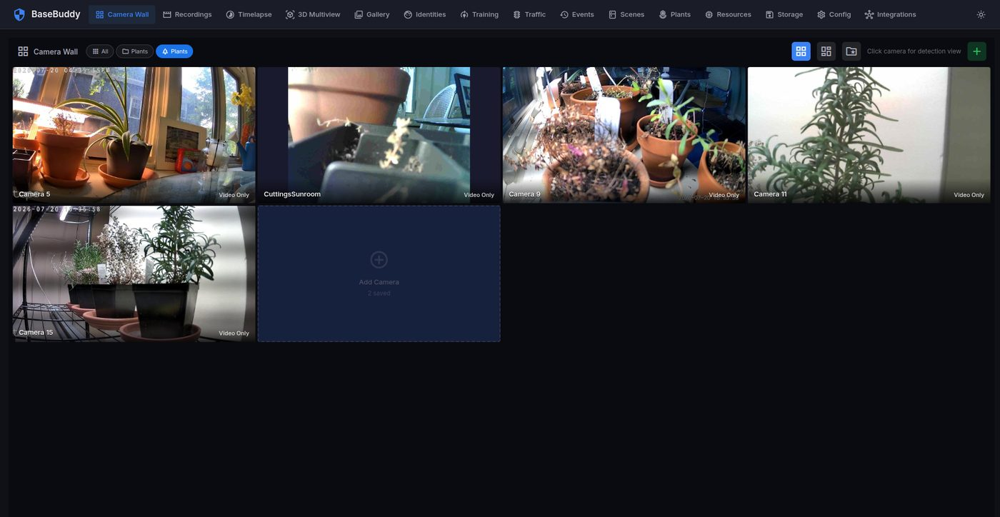
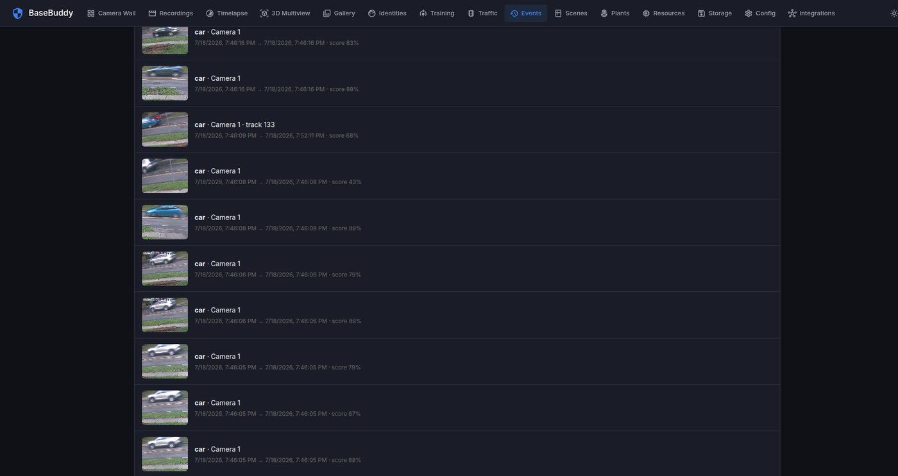
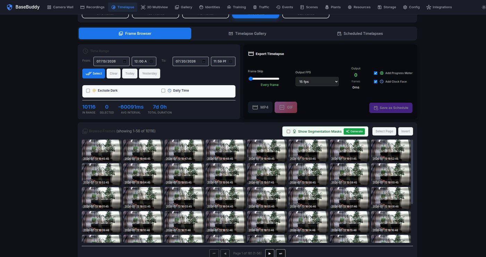
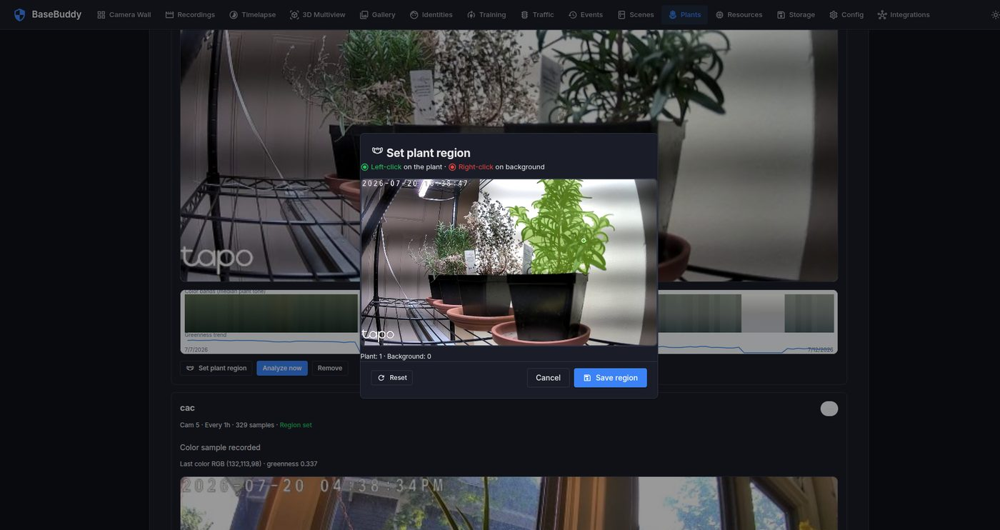
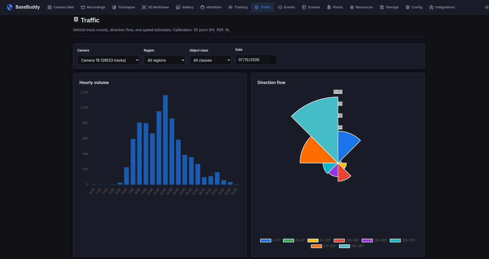

# BaseBuddy

Multi-camera recorder and detector. RTSP ingest, optional local YOLO, Flask UI. The process and its data stay on the machine that runs it.

Python 3.10+. License: MIT (`LICENSE`).

## Install

```bash
python3 -m venv venv
source venv/bin/activate
pip install -r requirements.txt
./setup.sh
```

Detection weights and the ML stack are in `requirements.txt`. For the UI without detection, install `requirements-core.txt` instead. Optional packages: [docs/OPTIONAL_DEPS.md](docs/OPTIONAL_DEPS.md).

## Configuration

```bash
cp env.example .env
```

`config.example.txt` copied to `config.txt` is the other supported source. Set `CAM1`, `CAM2`, … to RTSP URLs. `PORT` defaults to 5000. `AI_MODEL` defaults to `yolov8n.pt`; a missing file is downloaded on first run.

`.env` and `config.txt` are gitignored. They hold camera URLs and, when set, auth secrets.

## Run

```bash
./run.sh                 # foreground
./run.sh background      # logs/output.log, pid file .pid
./run.sh --safe          # reduced resource use
./run.sh --limit N       # cap active cameras
./stop.sh
```

UI: [http://127.0.0.1:5000](http://127.0.0.1:5000). Liveness: `GET /health` (no auth).

```bash
cp env.example .env
docker compose up -d
```

NVIDIA GPU: `docker compose -f docker-compose.yml -f docker-compose.gpu.yml up -d --build`.

`recordings/`, `stills/`, `timelapse_output/`, and `logs/` are bind-mounted from the repository root. See `docker-compose.yml`.

## Network

The default bind is `0.0.0.0:5000`. HTTP basic auth is off until enabled:

```bash
AUTH_ENABLE=true
ADMIN_USERNAME=admin
ADMIN_PASSWORD=<password>
SECRET_KEY=<long-random-string>
chmod 600 .env
```

Hardening: [docs/SECURITY.md](docs/SECURITY.md).

## Layout

| Path | Role |
| --- | --- |
| `basebuddy/` | Application package (app, core, modules, pages, plugins, templates, static) |
| `main.py` | Entry shim. Sets `BASEBUDDY_REPO_ROOT` and runs `basebuddy.main` |
| `run.sh`, `stop.sh` | Process control |
| `env.example` | Configuration template |
| `docs/` | Architecture, security, optional dependencies |
| `scripts/smoke_test.py` | Import and app-factory check used by CI |

The repository root holds configuration and runtime data. Importable code is under `basebuddy/`. Paths resolve in `basebuddy/core/paths.py`.

[Architecture](docs/ARCHITECTURE.md) · [Contributing](CONTRIBUTING.md)

## Interface










